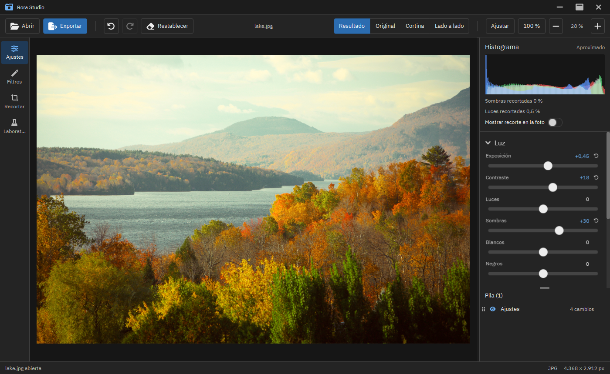

<div align="center">

# Rora Studio

Editor de imágenes de escritorio, no destructivo, con interfaz oscura inspirada en Adobe Lightroom y DaVinci Resolve.

[](https://openjdk.org/)
[](https://openjfx.io/)
[](LICENSE)
[](https://github.com/Erenriquezp/ImageProcessor/actions/workflows/ci.yml)



</div>

---

Aplicación de escritorio en **Java 21 + JavaFX 21**. Aplica filtros de forma no destructiva y en tiempo real, con un pipeline apilable y deshacer/rehacer paso a paso, además de herramientas de análisis (histograma RGB) y composición (blending de 2 y 3 capas). Toda la interfaz, incluida la barra de título, está construida a medida.

## Características

- **Edición no destructiva** — la imagen original nunca se altera en memoria.
- **Preview en vivo** — el resultado se recalcula al instante al cambiar de filtro o mover un control (cómputo en hilo de fondo para mantener la UI fluida).
- **Pipeline apilable + Deshacer/Rehacer** — cada filtro se aplica sobre el resultado del anterior; historial de hasta 30 pasos.
- **20 filtros** — básicos, transparencia, retro/cuantización, convolución 3×3 y matrices de color.
- **Navegador de filtros** — búsqueda instantánea y categorías colapsables.
- **Selector de color propio** — popover HSB con campo HEX y swatches curados.
- **Comparador antes/después** 50/50 y **zoom independiente por panel** (100–800 %).
- **Tablero de transparencia** para visualizar correctamente los filtros de alpha.
- **Barra de estado** con zoom %, coordenadas y valor RGB bajo el cursor.
- **Histograma RGB**, **blending** de 2 y 3 imágenes y **generador de degradados**.
- **Chrome de ventana sin bordes** (mover, maximizar, redimensionar).
- **Exportación** por extensión: `png`, `jpg`, `bmp`, `gif`.

## Estado del proyecto

El proyecto nació como trabajo académico (versión conservada en el tag `v0.1.0-academic` y en la rama `legacy/academic-v0`) y está en transición hacia un editor de imágenes más completo. Hoy **solo existe lo descrito en este README**; lo demás es trabajo futuro y se registra en el [CHANGELOG](CHANGELOG.md). El nombre definitivo del producto y la licencia final están pendientes de decisión.

## Requisitos

| Requisito | Versión |
|---|---|
| JDK | **21 o superior** (el bytecode apunta a Java 21; la compilación se verificó con Temurin 25) |
| Maven | No hace falta instalarlo: el wrapper `mvnw` descarga **Maven 3.9.11** |
| Sistema operativo | Windows, macOS o Linux con soporte OpenGL |

JavaFX y el resto de dependencias se descargan automáticamente vía Maven. Las versiones de Java y Maven se verifican con `maven-enforcer`.

## Inicio rápido

```bash
git clone https://github.com/Erenriquezp/ImageProcessor.git
cd ImageProcessor

./mvnw clean compile   # Windows (PowerShell): .\mvnw.cmd clean compile
./mvnw install -DskipTests          # instala los módulos en el repositorio local
./mvnw -pl app javafx:run           # Windows (PowerShell): .\mvnw.cmd -pl app javafx:run
./mvnw verify          # compila, tests, Checkstyle y cobertura (JaCoCo)
```

Comprobaciones opcionales: `./mvnw spotless:check` (formato; el código actual aún no está formateado) y `./mvnw compile spotbugs:check` (usar JDK 21). Para contribuir, consulta [CONTRIBUTING.md](CONTRIBUTING.md).

## Uso

- **Abrir** — botón Abrir o arrastra un archivo (`png`, `jpg`, `jpeg`, `bmp`, `gif`) al área central.
- **Aplicar filtros** — selecciona un filtro en el panel FILTROS; el efecto se ve al instante y los controles del panel AJUSTES actualizan la vista en vivo. Pulsa **Aplicar filtro** (o doble clic en la fila) para consolidarlo en el historial; el siguiente filtro parte de ese resultado, permitiendo apilar efectos.
- **Deshacer / Rehacer** — botones de la toolbar o `Ctrl+Z` / `Ctrl+Y`.
- **Comparar** — activa *Mostrar original* para ver original y resultado en paralelo.
- **Inspeccionar color** — mueve el cursor sobre la imagen para ver coordenadas y RGB en la barra de estado.
- **Guardar** — el formato se detecta por la extensión; el canal alpha sólo se preserva en `.png`.

Herramientas adicionales en pestañas: **Generador** de degradados (lineales y radial), **Histograma** RGB exportable, **Blending** de 2 imágenes con slider alpha en tiempo real y **Triple Blending** de 3 imágenes con pesos por canal.

## Atajos de teclado

| Acción | Resultado |
|---|---|
| `Ctrl + Z` | Deshacer el último filtro aplicado |
| `Ctrl + Y` · `Ctrl + Shift + Z` | Rehacer |
| Doble clic en una fila de filtro | Aplicar ese filtro directamente |
| Scroll ↑ / ↓ sobre un panel | Zoom in / out en ese panel |
| Botones `+` · `−` · `⊞` de la toolbar | Zoom in / out / ajustar a ventana |
| Arrastrar la barra de título | Mover la ventana (doble clic: maximizar) |
| Arrastrar un borde o esquina | Redimensionar la ventana |

## Catálogo de filtros

**Básicos:** Escala de grises · Negativo · Brillo (−100…+100) · HSV (saturación y valor) · Blanco y negro por umbral (0–255) · Recolorización (selector de color).

**Transparencia (alpha):** Vidrio esmerilado · Desvanecimiento circular · Transparencia global (0–255).

**Retro y cuantización:** Retro 1 (cuantización RGB, 2–255 niveles) · Retro 2 (glitch por canal R/G/B) · Grises cuantizados (2–64) · Reducción 4 bits + estiramiento (Binario/Decimal/Hexadecimal).

**Convolución 3×3:** Blur · Sharpen · Detección de bordes · Emboss.

**Matrices de color:** Sepia · Tono Frío · Tono Cálido · Polaroid · Kodachrome.

**Histograma:** Ecualización (RGB por canal o luminancia BT.709).

**Operaciones por punto:** Ajuste de color (ganancia R/G/B) · Interpolación · Extrapolación · Escala y bias · Umbralización (hard/soft) · Conversión a luminancia · Saturación · Rotación Hue · Espacio de color (RGB↔YCbCr / HSV / HSL).

**Pipeline gráfico:** Raster/Depth · Texturas/W-Buffer · Multisample/Alpha Test · Stencil/Blend/Logic Op.

## Arquitectura

Separación estricta en tres capas, con `service/ImageProcessor` como única fachada entre la UI y la lógica de procesamiento.

```
app/      Presentación y coordinación (ImageProcessorApp + ui/)
          estado de sesión, pipeline, undo/redo, preview en vivo
service/  Lógica pura sin estado (métodos estáticos); ImageProcessor = fachada
domain/   Enumeraciones (FilterType, ConvolutionKernel, GradientType, StretchMode)
```

Principios: edición no destructiva (`originalImage` intacta), pipeline apilable (los filtros se aplican sobre la imagen consolidada), servicios puros y seguros para el preview en background, y componentes de UI desacoplados mediante *callbacks*.

## Stack tecnológico

| Tecnología | Versión | Rol |
|---|---|---|
| Java | 21 (LTS) | Lenguaje base (bytecode) |
| JavaFX | 21.0.6 | Interfaz de escritorio |
| javafx-swing | 21.0.6 | Puente `BufferedImage ↔ Image` |
| Ikonli (FontAwesome 6) | 12.4.0 | Iconos vectoriales |
| Maven | 3.9.11 (wrapper) | Build y dependencias |
| JUnit Jupiter | 5.12.1 | Tests unitarios |

## Licencia

Distribuido bajo la licencia **MIT** (provisional) — consulta el archivo [LICENSE](LICENSE). Guía de contribución: [CONTRIBUTING.md](CONTRIBUTING.md). Arquitectura: [docs/ARCHITECTURE.md](docs/ARCHITECTURE.md).

## English summary

Rora Studio (formerly ImageProcessor) is a desktop image editor built with Java 21 and JavaFX 21: non-destructive, stackable filters with undo/redo, live preview, histogram, blending and a gradient generator. Requires JDK 21+; use the bundled Maven wrapper (`./mvnw install -DskipTests` then `./mvnw -pl app javafx:run`). The project is a work in progress and its name and license are provisional.


