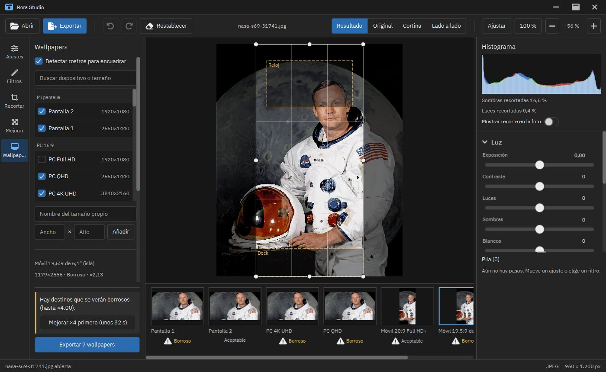

# Wallpapers

Convierte la foto abierta, con todos sus ajustes aplicados, en fondos de pantalla con la resolución exacta de uno o varios dispositivos a la vez. No es un paso de la receta: lee el resultado de la receta y escribe archivos nuevos.

Foto de la captura: retrato oficial de la NASA (S69-31741), dominio público, vía Wikimedia Commons.

## Uso

1. Abre una foto y elige **Wallpapers** en el riel.
2. Marca los dispositivos. La primera vez vienen elegidos tus monitores ("Mi pantalla"), 4K, QHD, un Android 1080×2400, un iPhone 1179×2556 y una tableta 1668×2388.
3. Pulsa una miniatura de la tira inferior para encuadrar ese destino en el visor: arrastra el rectángulo, cambia su tamaño con las asas (zoom manual) o usa los anclajes. **Auto** vuelve al encuadre automático; **Auto en todos**, en todos los destinos.
4. **Exportar N wallpapers** elige la carpeta, los nombres y el formato.

## Encuadre

| Modo | Qué hace |
|---|---|
| Cubrir | Recorta para llenar la pantalla. Una sola escala: el mayor rectángulo que cabe (sin zoom automático) |
| Contener | La foto entera, con relleno en los márgenes |
| Auto | Cubrir, salvo que se corte una cara o se pierda más del 80 % de la foto: entonces Contener |

El encuadre automático parte del recorte centrado y solo se mueve lo mínimo para no cortar caras. Deja un 10 % de margen alrededor de cada cara y, arriba, el menor de media cara y un 5 % del recorte. Si no caben todas, protege las más grandes. Si ni la mayor cabe, se centra entre los ojos y la boca. Sin caras, el recorte queda centrado.

Este algoritmo se eligió en tres rondas de hojas ciegas con fotos reales: no empeoró el centrado en ninguna de las 13 hojas donde se mueve, y en 7 evitó cortar una cara que el centrado cortaba.

Los rostros se detectan con YuNet (OpenCV Zoo, MIT, 0,23 MB), incluido en la aplicación y sin red. La detección corre al abrir la herramienta, fuera del hilo de la interfaz, y se guarda en caché mientras la receta no cambie. Se puede desactivar con **Detectar rostros**. Si el motor no está disponible, el encuadre es el centrado.

El tamaño de salida es siempre exactamente el del destino. El encuadre se calcula con decimales y cada píxel de salida toma su muestra en `x0 + (i + 0,5)·ancho/N − 0,5` de la foto, sin desplazamientos de medio píxel.

## Relleno

| Relleno | Construcción |
|---|---|
| Desenfoque (por defecto) | La foto reducida, desenfocada y oscurecida un 50 % (deslizador) |
| Espejo | Reflejo de la foto en los márgenes. Puede duplicar al sujeto; nunca es el predeterminado |
| Color sólido | Un color |

El 50 % salió de otra ronda de hojas ciegas: fue la intensidad preferida en 3 de 6 fotos. En esa misma ronda, el degradado del color dominante se rechazó en las 6, así que no se ofrece.

Los rellenos suaves llevan un tramado de 1 nivel que depende solo de la posición, de modo que el resultado es determinista. Solo se aplica en PNG: con JPEG de calidad normal la compresión lo borra y queda peor que sin tramar. En una rampa oscura, el error de banding baja de 0,115 a 0,003 niveles.

## Calidad

| Escala efectiva | Insignia |
|---|---|
| Hasta ×1,15 | Excelente |
| Hasta ×2 | Aceptable |
| Más de ×2 | Borroso |

Si algún destino amplía más de ×1,5, la herramienta sugiere **Mejorar ×2 o ×4 primero**, con el tiempo estimado. La escala es la menor que deja el peor destino en "Excelente", y se calcula una sola vez para todos. Pulsar la sugerencia equivale a usar Mejorar: el paso entra en la receta y se puede deshacer. La herramienta nunca ejecuta la IA por su cuenta. Si exportas con la mejora sin calcular, pregunta como la exportación normal.

Las miniaturas y el visor usan la vista reducida, así que son aproximadas: menos resolución, desenfoque escalado y sin tramado. El encuadre y las insignias se calculan con el tamaño real, y la exportación usa la foto completa.

## Dispositivos

35 clases integradas, con su fuente y fecha de revisión:

| Estado | Cuántos | Significado |
|---|---|---|
| Verificado | 21 | Leído en la página oficial del fabricante (Apple, Microsoft), revisado el 2026-11-13 |
| Estándar | 7 | FHD, QHD, 4K, WUXGA, ultrapanorámicos: sin un fabricante único |
| Aproximado | 7 | Sin fuente oficial directa (Samsung, Google, Framework); la interfaz lo avisa |

**Mi pantalla** añade cada monitor con su resolución física (tamaño lógico × escala del sistema). No se guarda.

Los tamaños propios se guardan en `%APPDATA%\RoraStudio\wallpapers` (Windows), `~/Library/Application Support/RoraStudio/wallpapers` (macOS) o `~/.local/share/rora-studio/wallpapers` (Linux). Se leen todos los `.json` de esa carpeta, sin subcarpetas ni enlaces. Un archivo o una entrada no válidos se ignoran con aviso. El esquema está en `PresetCodec`.

**Girar** intercambia ancho y alto, por ejemplo para una tableta en horizontal.

## Zonas seguras

Los móviles y los portátiles con muesca llevan rectángulos normalizados donde suelen ir el reloj, el dock o la barra de menús. Se dibujan sobre el encuadre y la herramienta avisa si una cara queda en buena parte debajo. Son orientativas: valores genéricos, no medidos, que cambian con cada modelo y configuración.

## Exportación

- **Carpetas**: `{nombre} - wallpapers/{grupo}/` por defecto.
- **Nombres**: `{nombre}_{dispositivo}_{ancho}x{alto}`. Admite además los tokens de la exportación normal: `{fecha}`, `{hora}`, `{n}` y `{formato}`. Cada segmento se sanea por separado, así que ningún nombre sale de la carpeta elegida.
- **Colisiones**: se comprueban antes de empezar, con una sola pregunta para toda la tanda (numerar o sobrescribir). Dos destinos con el mismo nombre se numeran.
- **Formato Auto**: PNG si el destino lleva desenfoque, porque así conserva el tramado; si no, JPEG de calidad 95 con 4:4:4. Se puede forzar uno u otro.
- **Metadatos**: por defecto se quitan todos, incluida la marca de IA.
- **Escritura**: cada archivo es atómico. Un destino que falla se registra y los demás siguen. Cancelar deja solo los archivos ya terminados, sin temporales. El informe final lista los fallos y ofrece "Mostrar en carpeta".
- **Memoria**: se renderiza un destino cada vez. Con 24 MP y 8 destinos, el pico de heap medido fue de 318 MB con `-Xmx1536m`.

## Tiempos

Medidos en caliente con 24 MP, en un i5-1035G1 con 7 hilos:

| Paso | Tiempo |
|---|---|
| Detección de rostros | 199 ms |
| Encuadrar a 4K / 5K | 75 / 156 ms |
| Contener con desenfoque a 4K / 5K | 207 / 275 ms |
| Guardar JPEG 4K / 5K | 0,40 / 0,71 s |
| Guardar PNG 4K / 5K | 1,34 / 2,31 s |

## Límites

- El encuadre automático se validó con 10 fotos.
- Las resoluciones de móvil cambian cada año. Las aproximadas conviene comprobarlas en el dispositivo real.
- Fuera de alcance: generadores de fondos, lotes de varias fotos, fijar el fondo del sistema, fondos que abarcan varios monitores, rellenado generativo y zoom automático.

## Código

| Módulo o paquete | Contenido |
|---|---|
| `wallpapers` (`...rora.wallpapers`) | Lógica pura, solo `java.base` y el núcleo: `preset`, `geom`, `frame` (encuadre), `subject` (SPI `SubjectDetector`), `render` (remuestreo en luz lineal, rellenos, tramado), `plan` (plan, tanda, nombres) |
| `ai-engine` `ai.face` / `ai.onnx.YuNetDetector` | Decodificación de YuNet en Java puro y su sesión de ONNX Runtime |
| `app.session.wallpaper` | Análisis, miniaturas y exportación sobre el exportador atómico |
| `app.viewmodel.WallpapersViewModel`, `app.view.WallpapersView` | Interfaz |

Las reglas de ArchUnit lo hacen cumplir: sin AWT, JavaFX, ONNX Runtime ni red en `wallpapers`; render, tanda y detectores solo desde la capa de sesión.
